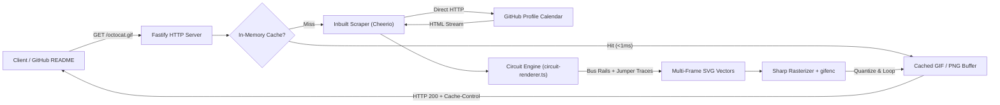

# Commit Circuit

> **Dynamic GitHub contribution electronic circuit generator.**  
> Turn code commits into an authentic PCB / breadboard schematic rendered as an animated **GIF**, crisp **PNG**, or vector **SVG**.

[](https://fastify.dev/)
[](https://bun.sh/)
[](https://www.typescriptlang.org/)
[-yellow?style=flat-square>)](https://nodejs.org/api/esm.html)
[-green?style=flat-square&logo=github>)](https://github.com/nishur31/github-contributions-api)

---

## How It Works Under the Hood

Unlike traditional badge generators that depend on external APIs or slow browser headless renderers, **Commit Circuit** operates as a self-contained rendering engine built on **Bun** and **Fastify**.



### 1. Inbuilt Direct GitHub Scraping

- Fetches contribution calendars directly from `https://github.com/users/{username}/contributions` using **Cheerio** (incorporating the architecture from [`nishur31/github-contributions-api`](https://github.com/nishur31/github-contributions-api) / `grubersjoe`).
- Inspects exact commit counts from native GitHub calendar tooltips (`tool-tip[for=id]`).
- Calculates streak metrics, peak frequencies, and activity ratios locally with zero reliance on third-party hosted API services.

### 2. Algorithmic Circuit Layout & Wire Generation

- Maps 52–53 weeks × 7 days into a hardware PCB grid.
- Constructs **dual power bus rails**:
  - **Top Rail**: `+5V VCC` (Red)
  - **Bottom Rail**: `GND` (Blue)
- Computes multi-colored jumper wires (Red, Blue, Green, Yellow) and 45° chamfered PCB traces interconnecting consecutive commit streaks and active node clusters.

### 3. High-Speed Frame Generation & Encoding

- **Sharp** renders SVG vector frames into raw RGBA buffers in parallel.
- **`gifenc`** quantizes an optimized 128-color palette and streams looping frames (~80–120ms total generation time, ~40–80KB).
- **In-Memory LRU Cache** retains rendered buffers and scraped histories with automated TTL eviction, serving subsequent requests in under **1 millisecond**.

---

## Wire Connection Hierarchy

The circuit employs an authentic electronics breadboard signal hierarchy where wire colors and node styles correspond to activity intensity:

| Wire Signal        | Hex Code  | Electrical Bus   | Contribution Level | Description                                                    |
| :----------------- | :-------- | :--------------- | :----------------- | :------------------------------------------------------------- |
| **Signal Red**     | `#ef4444` | **+5V VCC Rail** | **9+ commits**     | High-energy power line; feeds the highest-frequency days.      |
| **Emerald Green**  | `#22c55e` | **DATA Stream**  | **6–8 commits**    | High-speed telemetry wire; active sequential data transfers.   |
| **Vibrant Yellow** | `#eab308` | **CLOCK Strobe** | **3–5 commits**    | System clock line; modulated square waves connecting clusters. |
| **Royal Blue**     | `#2563eb` | **GND Rail**     | **1–2 commits**    | Logic low return wire; ground bus drops.                       |
| **Solder Tin**     | `#162330` | **IDLE Pad**     | **0 commits**      | Unconnected copper drill pad awaiting signal.                  |

---

## Quick Examples

### Octocat Example

#### 1. GitHub Profile README (Markdown)

```markdown
[](https://github.com/octocat)
```

#### 2. HTML `` Embed with Custom Theme & Wires

```html
<a href="https://github.com/octocat">
  
</a>
```

#### 3. Direct URLs Exaples

- **Animated GIF**: `http://localhost:3000/octocat.gif`
- **Crisp Retina PNG**: `http://localhost:3000/octocat.png?scale=2`
- **Scalable Vector SVG**: `http://localhost:3000/octocat.svg`
- **JSON Telemetry Data**: `http://localhost:3000/api/data?user=octocat`

---

## Customization Guide

All parameters can be passed as query parameters to `/api/circuit`, `/api/circuit.gif`, `/api/circuit.png`, or direct user vanity routes (`/:user.gif`, `/:user.png`, etc.).

### 1. Wire Connection Modes (`wireMode`)

| Mode                   | Parameter Value   | Visual Behavior                                                                       |
| :--------------------- | :---------------- | :------------------------------------------------------------------------------------ |
| **Hybrid** _(Default)_ | `wireMode=hybrid` | Combines dual bus rails (+5V/GND drops), PCB traces, and multi-colored jumper wires.  |
| **Curved Jumpers**     | `wireMode=jumper` | 3D arched Dupont jumper wires with metallic pin collars looping across nodes.         |
| **PCB Traces**         | `wireMode=pcb`    | 45-degree angled orthogonal copper routing with micro-vias and solder-mask clearance. |
| **Dual-Rail Bus**      | `wireMode=bus`    | Address/data bus architecture dropping vertically from top and bottom voltage rails.  |
| **Streak Connectors**  | `wireMode=streak` | Continuous glowing signal wire bundles connecting consecutive active days.            |

### 2. Built-in Color Themes (`theme`)

| Theme Name                     | Value              | Description                                                                       |
| :----------------------------- | :----------------- | :-------------------------------------------------------------------------------- |
| **Breadboard Pro** _(Default)_ | `theme=breadboard` | Authentic multi-colored jumper wires: Red, Blue, Green, Yellow on dark substrate. |
| **Classic Green PCB**          | `theme=pcb`        | Industrial FR4 soldermask green with gold ENIG pads and copper traces.            |
| **Cyberpunk Neon**             | `theme=cyberpunk`  | Neon cyan, hot pink, and ultraviolet signals with dark purple PCB plate.          |
| **Vintage Amber CRT**          | `theme=amber`      | 1980s phosphor oscilloscope amber & retro vacuum tube glow.                       |
| **Matrix Digital Rain**        | `theme=matrix`     | Pure terminal phosphor green with cascading digital bus conduits.                 |
| **Solarized Dark**             | `theme=solarized`  | Precision teal, cyan, and copper routing based on Ethan Schoonover's palette.     |
| **Stealth Titanium**           | `theme=monochrome` | Minimalist matte dark board with titanium traces and pure white LEDs.             |

### 3. Circuit Node Styles (`nodeStyle`)

| Style                    | Value           | Description                                                               |
| :----------------------- | :-------------- | :------------------------------------------------------------------------ |
| **Dome LED** _(Default)_ | `nodeStyle=led` | 3mm surface-mount LED with outer bezel ring and pulsing optical dome.     |
| **SMD Solder Pad**       | `nodeStyle=smd` | Square copper surface-mount pad with silver/tin solder fillet center dot. |
| **Through-Hole**         | `nodeStyle=pad` | Circular PCB drill hole with golden copper annular ring.                  |
| **Hex Terminal**         | `nodeStyle=hex` | Futuristic cyberpunk hexagonal micro-pad.                                 |

---

## Query Parameter Reference

| Parameter    | Type      | Default      | Options / Valid Range                                                          | Description                                                   |
| :----------- | :-------- | :----------- | :----------------------------------------------------------------------------- | :------------------------------------------------------------ |
| `user`       | `string`  | `octocat`    | Any public GitHub username                                                     | GitHub user profile to graph.                                 |
| `year`       | `string`  | `last`       | `last`, `2026`, `2025`, `2024`, ...                                            | Contribution period.                                          |
| `format`     | `string`  | `png`        | `gif`, `png`, `svg`                                                            | File format (or use route extensions `.gif`/`.png`).          |
| `theme`      | `string`  | `breadboard` | `breadboard`, `pcb`, `cyberpunk`, `amber`, `matrix`, `solarized`, `monochrome` | Board color palette preset.                                   |
| `wireMode`   | `string`  | `hybrid`     | `hybrid`, `jumper`, `pcb`, `bus`, `streak`                                     | Wire geometry and routing style.                              |
| `nodeStyle`  | `string`  | `led`        | `led`, `smd`, `pad`, `hex`                                                     | Node footprint aesthetic.                                     |
| `density`    | `number`  | `2`          | `1` (sparse), `2` (medium), `3` (dense), `4` (ultra)                           | Number of active inter-node trace jumps.                      |
| `glow`       | `number`  | `70`         | `0` to `100`                                                                   | Aura glow intensity on active signal nodes.                   |
| `speed`      | `string`  | `normal`     | `slow` (8 fps), `normal` (11 fps), `fast` (16 fps)                             | GIF pulse loop speed.                                         |
| `frames`     | `number`  | `10`         | `8` to `16`                                                                    | Number of loop frames generated for the GIF.                  |
| `scale`      | `number`  | `1`          | `1` or `2`                                                                     | Resolution multiplier for PNG rendering.                      |
| `stats`      | `boolean` | `true`       | `1`/`0`, `true`/`false`                                                        | Silkscreen telemetry header with commit counts.               |
| `months`     | `boolean` | `true`       | `1`/`0`, `true`/`false`                                                        | Silkscreen month indicators (`JAN`, `FEB`, ...).              |
| `days`       | `boolean` | `true`       | `1`/`0`, `true`/`false`                                                        | Day-of-week labels (`MON`, `WED`, `FRI`).                     |
| `legend`     | `boolean` | `true`       | `1`/`0`, `true`/`false`                                                        | Silkscreen wire hierarchy key at the bottom.                  |
| `chip`       | `boolean` | `true`       | `1`/`0`, `true`/`false`                                                        | Silkscreen microcontroller IC chip package graphic.           |
| `wireColors` | `string`  | —            | Comma-separated hex values                                                     | Custom wire palette (e.g. `#ef4444,#2563eb,#22c55e,#eab308`). |
| `color`      | `string`  | —            | Hex color string                                                               | Custom accent/pulse color override.                           |
| `bg`         | `string`  | —            | Hex color string                                                               | Custom background canvas color override.                      |

---

## Tech Stack & Architecture

| Component       | Technology           | Rationale                                                                            |
| :-------------- | :------------------- | :----------------------------------------------------------------------------------- |
| **Runtime**     | **Bun 1.4+**         | Native TypeScript execution, ESM module loading, instant startup, fast I/O.          |
| **Web Server**  | **Fastify v5**       | Extremely high request throughput, built-in schema handling, CORS support.           |
| **Scraper**     | **Cheerio**          | Fast server-side DOM parser for extracting GitHub contributions without API keys.    |
| **Rasterizer**  | **Sharp**            | High-performance C/vips-backed vector-to-bitmap rasterizer for sub-millisecond PNGs. |
| **GIF Engine**  | **gifenc**           | Zero-dependency NeuQuant palette quantizer and streaming GIF encoder.                |
| **Frontend UI** | **Vanilla CSS + JS** | Glassmorphic electronics workbench studio; zero heavy client-side runtime libraries. |

---

## Project Directory Structure

```
circuit/
├── src/
│   ├── server.ts           # Fastify server entry point & route definitions
│   ├── imageHandler.ts     # Request router for GIF, PNG, and SVG rendering
│   ├── github.ts           # Inbuilt direct GitHub profile scraper & stats engine
│   ├── circuit-renderer.ts # Parametric SVG electronic circuit generator
│   ├── image-encoder.ts    # Sharp + gifenc rasterization & animation pipeline
│   └── themes.ts           # Color schemes and wire voltage definitions
├── public/
│   ├── index.html          # Interactive Workbench UI & Documentation
│   ├── style.css           # Workbench dark laboratory & glassmorphic styling
│   └── app.js              # Real-time preview generator, tabs & clipboard manager
├── index.ts                # Root application entry point
├── tsconfig.json           # TypeScript configuration for Bun
└── package.json            # Module configuration (type: module)
```

---

## API Endpoints Summary

### Image Routes

- `GET /:user.gif` — Direct animated GIF
- `GET /:user.png` — Direct PNG
- `GET /:user.svg` — Direct SVG
- `GET /api/circuit.gif` — Formatted GIF route with query options
- `GET /api/circuit.png` — Formatted PNG route with query options
- `GET /api/circuit.svg` — Formatted SVG route with query options

### Telemetry & Meta Routes

- `GET /api/data?user=:user&year=:year` — Returns JSON with streak metrics, active days, and daily contribution counts.
- `GET /api/themes` — Returns list of all color theme palettes.
- `GET /api/health` — Returns server uptime, memory usage, and cache metrics.
- `GET /` — Serves the interactive workbench homepage.
